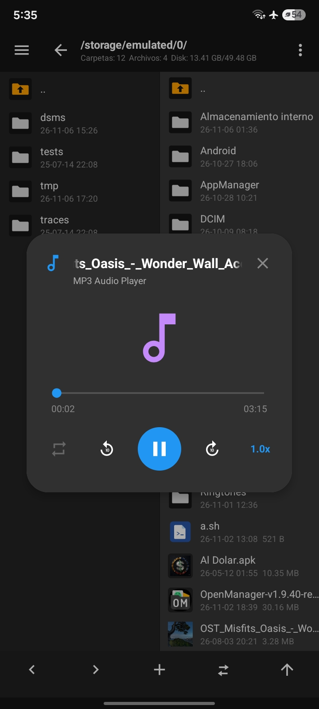
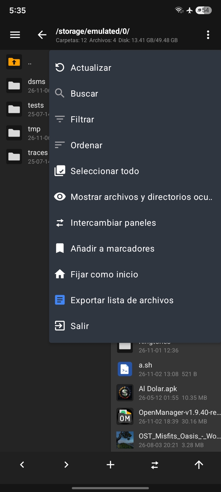
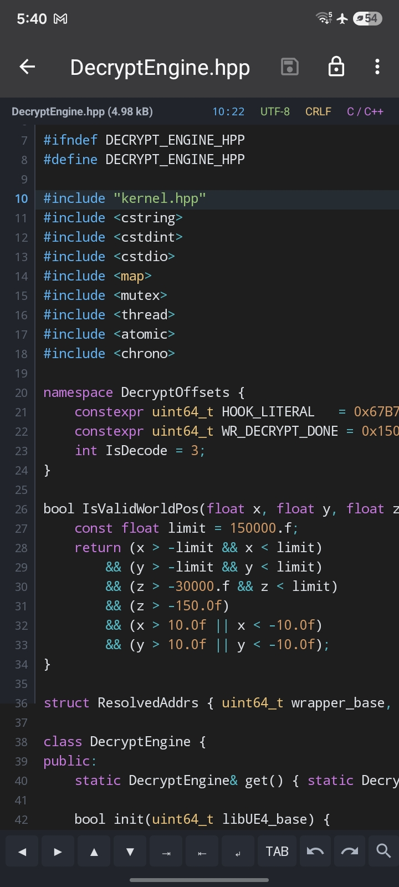
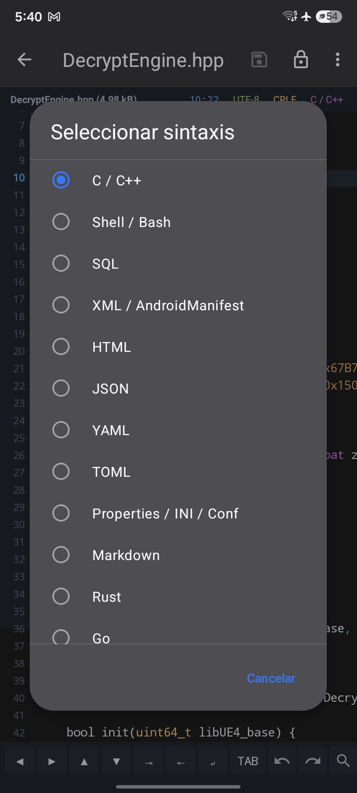
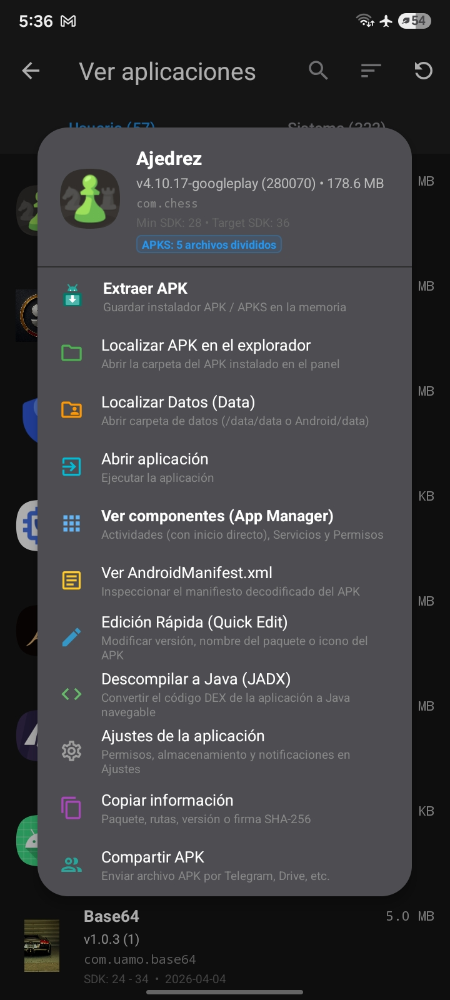
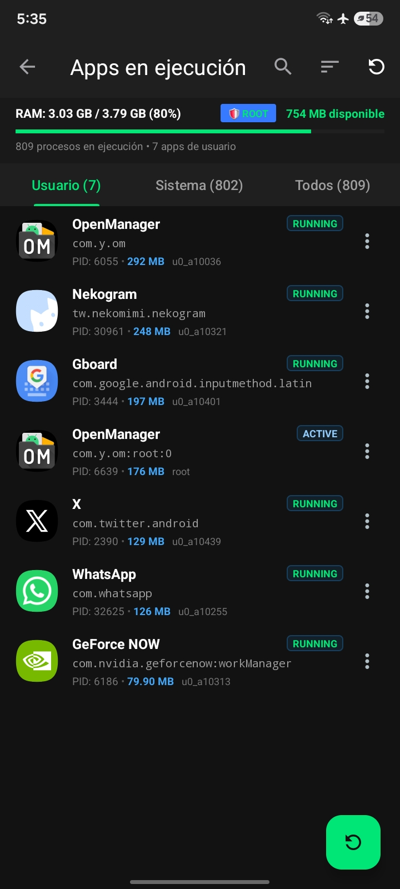
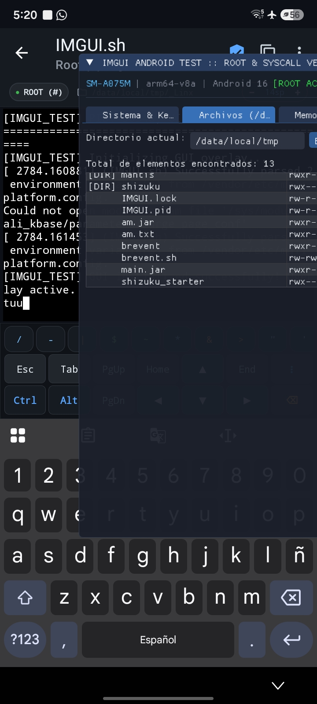
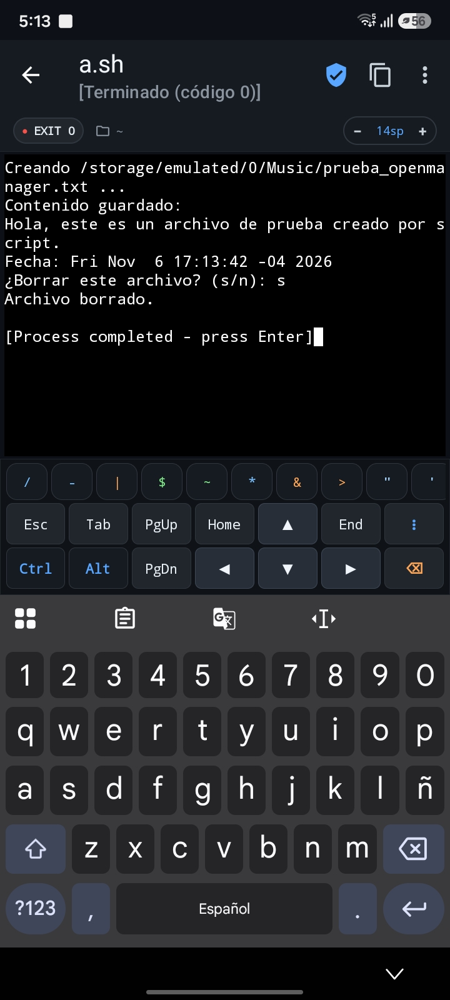

<p align="center">
  
</p>

<h1 align="center">OpenManager</h1>
<p align="center"><b>Gestor de archivos de doble panel y suite de ingeniería inversa de código abierto para Android</b></p>
<p align="center"><i>Alternativa completa, moderna y 100% gratuita a MT Manager</i></p>

<p align="center">
  <a href="https://uamo11.github.io/OpenManager/"></a>
  <a href="https://github.com/uamo11/OpenManager/actions/workflows/android.yml"></a>
  <a href="https://github.com/uamo11/OpenManager/releases"></a>
  <a href="LICENSE"></a>
  
  
  
</p>

<p align="center">
  🌐 <b>Sitio Web Oficial:</b> <a href="https://uamo11.github.io/OpenManager/"><b>uamo11.github.io/OpenManager</b></a><br>
  <a href="README_en.md">English</a> · <a href="README.md">Español</a> · <a href="README_zh-CN.md">简体中文</a>
</p>

---

## 📖 Descripción General

**OpenManager** es un avanzado administrador de archivos para Android con **interfaz de doble panel simultáneo** (paridad completa estilo MT Manager) y una **suite integral de ingeniería inversa y modding** integrada en tu propio dispositivo móvil.

Permite administrar con fluidez el almacenamiento interno, tarjetas MicroSD, particiones protegidas del sistema y servidores remotos, al mismo tiempo que incorpora potentes utilidades para **descompilar a Java (JADX), editar código Smali/DEX, inspeccionar binarios con editor HEX y Data Inspector, editar recursos ARSC/AXML, fusionar paquetes divididos (AntiSplit), firmar APKs (V1–V3) y ejecutar scripts en su terminal con Root o Shizuku**, todo sin recurrir a una computadora.

Cuenta con integración nativa para **Root** (Magisk, KernelSU, KernelSU Next, APatch) y **Shizuku** (acceso sin root vía ADB a `Android/data` y `Android/obb`), junto con el blindaje exclusivo **DFROOT / Hombre Muerto**, desarrollado para prevenir brickeos accidentales del sistema.

---

## 📸 Capturas de Pantalla (Preview)

<table align="center" width="100%">
  <tr>
    <td align="center" width="25%">
      <br>
      <sub><b>Doble Panel & Audio MP3</b></sub>
    </td>
    <td align="center" width="25%">
      <br>
      <sub><b>Gestión y Menú MT</b></sub>
    </td>
    <td align="center" width="25%">
      <br>
      <sub><b>Editor de Código $O(N)$</b></sub>
    </td>
    <td align="center" width="25%">
      <br>
      <sub><b>Selector de 39 Sintaxis</b></sub>
    </td>
  </tr>
  <tr>
    <td align="center" width="25%">
      <br>
      <sub><b>Suite APK, JADX y Modding</b></sub>
    </td>
    <td align="center" width="25%">
      <br>
      <sub><b>Monitor RAM & Procesos Root</b></sub>
    </td>
    <td align="center" width="25%">
      <br>
      <sub><b>Terminal Root (#) & Scripts</b></sub>
    </td>
    <td align="center" width="25%">
      <br>
      <sub><b>Ejecución Interactiva Shell</b></sub>
    </td>
  </tr>
</table>

---

## ✨ Características Principales

### 🗂️ 1. Explorador de Doble Panel (Estilo MT Manager)
* **Paneles A y B Independientes:** Visualiza y navega dos directorios diferentes en paralelo con sincronización instantánea y vista dividida.
* **Operaciones Directas entre Paneles:** Copiado, traslado y sincronización rápida de archivos entre paneles opuestos.
* **Barra de Navegación Breadcrumbs:** Historial con salto a niveles superiores y estadísticas del disco en vivo (carpetas, archivos, espacio usado y total).
* **Menú Rápido de Gestión:** Filtrar, ordenar, buscar, seleccionar todo, fijar carpetas como inicio, marcadores e intercambio fluido de paneles.

### 🛠️ 2. Suite de Ingeniería Inversa y Modificación
* **Editor DEX & DEX Plus:**
  * Desensamblado y ensamblado de Smali en tiempo real impulsado por Baksmali/Smali.
  * Explorador jerárquico de paquetes, clases, métodos, campos y tabla global de cadenas (`string_ids`).
  * Guardado atómico directamente al archivo `.dex` con recompilación limpia.
* **Descompilador JADX Integrado:** Inspecciona el código fuente en Java legible a partir de archivos APK y DEX al instante.
* **Editor HEX Virtualizado:**
  * Rendimiento ultra-fluido fila por fila (16 bytes por línea con offset, hexadecimal y ASCII).
  * **Inspector de Datos:** Interpretación en tiempo real (Int8, Int16 LE, Int32 LE, Float32, Binario y ASCII).
  * Búsqueda y reemplazo flexible de cadenas de texto o secuencias de bytes.
  * Historial de Deshacer / Rehacer, salto directo a offset y cálculo de checksums (MD5, SHA-1, SHA-256).
* **Editor de Recursos ARSC (`resources.arsc`):**
  * Navegación por pestañas (Cadenas, Recursos, Paquetes) con edición directa de valores y recálculo automático de chunks.
* **Motor AXML Binario:**
  * Decodificación y reconstrucción de `AndroidManifest.xml` binario con actualización del pool de cadenas.

### 📦 3. Herramientas de APK, Firma y AntiSplit
* **Menú de Acciones Rápidas APK (App Manager):**
  * Acciones directas sobre cualquier app: **Extraer APK**, **Localizar en el explorador**, **Localizar Datos (`/data/data`)**, **Ver componentes (Actividades, Servicios, Permisos)**, **Ver `AndroidManifest.xml`**, **Edición Rápida (Quick Edit)**, **Descompilar a Java (JADX)** y **Compartir APK**.
* **Motor AntiSplit (Unificador de Split APKs):**
  * Detecta y fusiona paquetes divididos (`APKS`, `.xapk` o splits múltiples) en un único archivo APK universal y autofirmado.
* **Firma Digital Avanzada:** Soporte para esquemas **V1 (Jar Signature)**, **V2 (Full APK Signature)** y **V3 (APK Signature Scheme v3)** con verificación de firmas y certificados.
* **Generador de Keystores (.jks):**
  * Crea almacenes de claves personalizados (RSA 2048 / 4096 bits) directamente en la app con BouncyCastle, sin depender de PC ni `keytool`.
* **Descompilación y Reconstrucción con Apktool:** Desempaqueta y reconstruye recursos y manifiestos en el propio teléfono.
* **Optimización Zipalign:** Alineación de binarios a 4 bytes para compatibilidad y ejecución óptima en Android.
* **Visor y Extractor de Iconos:** Previsualización en alta definición y exportación a PNG en `/sdcard/Download/`.

### 🛡️ 4. Superusuario, Shizuku y Protección DFROOT "Hombre Muerto"
* **Compatibilidad Root Completa:** Integración con **Magisk**, **KernelSU**, **KernelSU Next** y **APatch** mediante libsu.
* **Soporte Nativo de Shizuku:**
  * Comunicación directa por binder para acceso administrativo sin Root a carpetas restringidas (`/Android/data` y `/Android/obb`) en Android 11 a 15.
  * Detección de servidor Shizuku (ADB API vs Root API) e instalación privilegiada de APKs y Split APKs.
* **Sistema de Seguridad DFROOT "Hombre Muerto" (Dead Man):**
  * Blindaje preventivo contra brickeos en dispositivos con **DFRoot / DirtyFlag** y bootloaders bloqueados.
  * Bloqueo proactivo de comandos peligrosos (`mount remount`, escrituras raw en bloques `/dev/block/`, borrado de `/system`, `/vendor`, etc.).
  * **Diálogo "DirtyFlag Protection":** Cuenta regresiva forzosa de 5 segundos con aviso explícito de riesgo antes de permitir cambios en particiones críticas.
  * Visor categorizado de archivos protegidos (imágenes de arranque, firmware AVB, archivos de inicio y nodos raw).

### 💻 5. Editor de Código y Texto de Alto Rendimiento
* **Tokenizador $O(N)$ en Segundo Plano:** Resaltado de sintaxis fluido para **39 lenguajes** (C/C++, Shell/Bash, SQL, XML, HTML, JSON, YAML, TOML, Markdown, Rust, Go, Python, etc.).
* **Barra de Atajos de Teclado:** Flechas direccionales de precisión, sangría y des-indentación rápida, tecla TAB, Deshacer/Rehacer y búsqueda.
* **Edición Avanzada:** Búsqueda y reemplazo con expresiones regulares (regex), distinción de mayúsculas y conteo interactivo de coincidencias.
* **Tira de Estado Interactiva:** Alternador rápido de fin de línea **LF ⇄ CRLF**, selector de codificaciones (UTF-8, GBK, UTF-16, ISO-8859-1), selector de sintaxis y salto a línea.

### ⚡ 6. Gestor de Procesos y Apps en Ejecución
* **Monitor de Memoria en Vivo:** Supervisión de consumo de RAM (PSS, VmRSS, Java Heap) en tiempo real con tarjeta gráfica de estado (`3.03 GB / 3.79 GB (80%)`).
* **Control de Procesos:** Cierre forzado y detención de aplicaciones del sistema o de usuario con insignias de elevación (`🛡️ ROOT` / `⚡ SHIZUKU`).
* **Filtros por Categoría:** Pestañas dedicadas para procesos de **Usuario**, procesos del **Sistema** y **Todos**.
* **Extracción de APKs Ultra-rápida:** Transferencia con canales de entrada/salida directos zero-copy (`FileChannel.transferTo`).

### 🌐 7. Red, Terminal y Multimedia
* **Terminal Integrada con Soporte Root (#):**
  * Shell interactiva con teclado terminal ampliado (Esc, Tab, Ctrl, Alt, flechas, PgUp, PgDn, Home, End).
  * Ejecución de scripts shell (`.sh`) con captura de salida interactiva, indicador de retorno (`EXIT 0`) y zoom de fuente en vivo.
  * Compatibilidad con comandos de depuración, syscalls, binarios en `/data/local/tmp` e integración con **Termux**.
* **Reproductor de Audio Flotante:** Reproduce pistas MP3/audio en una ventana modal sin pausar la exploración, con control de velocidad (1.0x a 2.0x), salto de ±10 segundos, barra de progreso y bucle.
* **Servidor FTP Integrado:** Comparte archivos de forma inalámbrica en red local con cualquier PC o navegador sin cables.
* **Cliente de Red Multi-protocolo:** Conéctate a servidores **FTP, SFTP, SMB (Windows Share) y WebDAV**.

---

## 📊 Comparativa con MT Manager

| Característica | MT Manager (Original) | OpenManager |
| :--- | :---: | :---: |
| **Licencia** | Código cerrado (Propietario) | **100% Código Abierto (GPLv3)** |
| **Publicidad y Rastreadores** | Sí | **Cero Anuncios / Cero Telemetría** |
| **Doble Panel Simultáneo** | ✅ | ✅ |
| **Edición DEX / Smali** | Requiere VIP (Pago) | **Totalmente Gratuito** |
| **Descompilación JADX** | Requiere VIP (Pago) | **Totalmente Gratuito** |
| **Editor HEX + Inspector de Datos** | ✅ | ✅ |
| **Editor ARSC y AXML** | Requiere VIP (Pago) | **Totalmente Gratuito** |
| **Unificador AntiSplit (Split APKs)** | ✅ | ✅ |
| **Soporte Shizuku (Sin Root)** | Limitado / No nativo | **Integración Nativa Completa** |
| **Protección DFROOT "Hombre Muerto"** | ❌ No disponible | **Incluida de serie** |
| **Generador de Keystores en App** | Limitado | **RSA 2048/4096 (JKS, BKS, PK8)** |

---

## 🚀 Compilación desde el Código Fuente

### Requisitos Previos
* **JDK 21** (Java Development Kit)
* **Android SDK** con `platforms;android-35` y `build-tools;35.0.0`

### Instrucciones de Compilación
```bash
# 1. Clonar el repositorio
git clone https://github.com/uamo11/OpenManager.git
cd OpenManager

# 2. Compilar APK en modo Debug
./gradlew assembleDebug

# El archivo compilado se generará en:
# app/build/outputs/apk/debug/app-debug.apk
```

Para generar versiones de **Release firmadas**, copia `signing.properties.example` como `signing.properties` y define los parámetros de tu almacén de claves.

---

## 📦 Versiones y Descargas

Las notas de cada versión, el registro de cambios detallado y las compilaciones se publican de forma oficial en la sección de releases de GitHub:

👉 **[Consultar versiones en GitHub Releases](https://github.com/uamo11/OpenManager/releases)**

---

## 🤝 Contribuir

¡Las contribuciones, reportes de fallos y solicitudes de mejoras son siempre bienvenidas!

1. 🐛 **¿Encontraste un fallo?** Envía un reporte con detalles en [Nuevo Issue de Fallo](https://github.com/uamo11/OpenManager/issues/new/choose).
2. 💡 **¿Tienes una idea o sugerencia?** Abre un [Feature Request](https://github.com/uamo11/OpenManager/issues/new/choose).
3. 🔧 **¿Deseas enviar código?** Haz un fork, crea tu rama de trabajo y abre un Pull Request siguiendo nuestra plantilla.

---

## 🛡️ Seguridad y Privacidad

OpenManager se ejecuta de manera 100% local en tu dispositivo móvil. No recopila, almacena ni transmite ningún dato personal, archivo ni telemetría hacia servidores de terceros.

* [Política de Seguridad (SECURITY.md)](SECURITY.md)
* [Política de Privacidad (PRIVACY.md)](PRIVACY.md)

---

## 📜 Licencia

OpenManager se distribuye bajo los términos de la **GNU General Public License v3.0 (GPL v3)**. Consulta el archivo [LICENSE](LICENSE) para más detalles.

```text
OpenManager - Open Source Dual-Panel File Manager for Android
Copyright (C) 2018-2026 Hai Zhang, uamo11 & Colaboradores.

This program is free software: you can redistribute it and/or modify
it under the terms of the GNU General Public License as published by
the Free Software Foundation, either version 3 of the License, or
(at your option) any later version.
```
