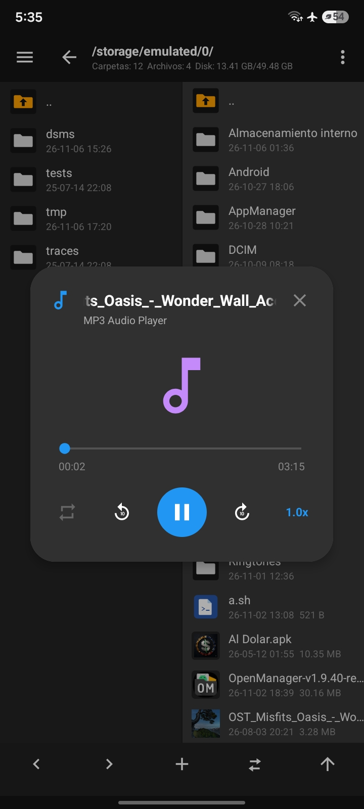
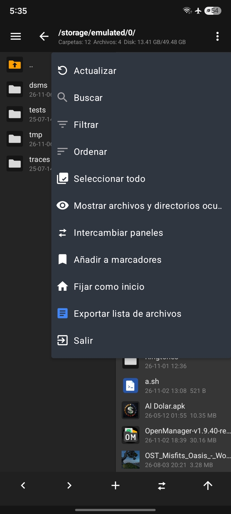
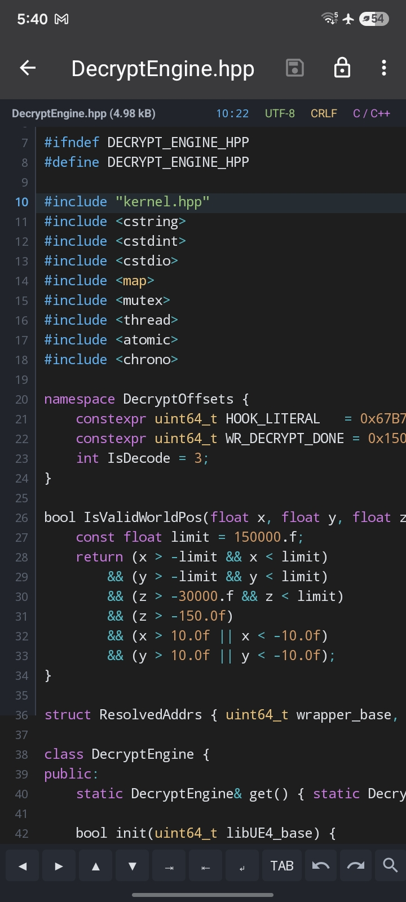
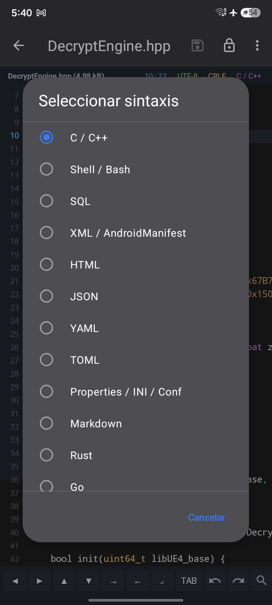
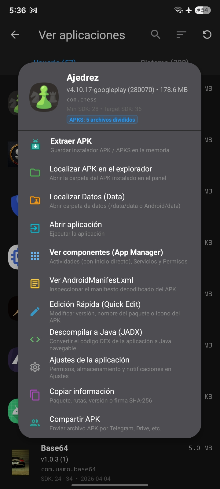
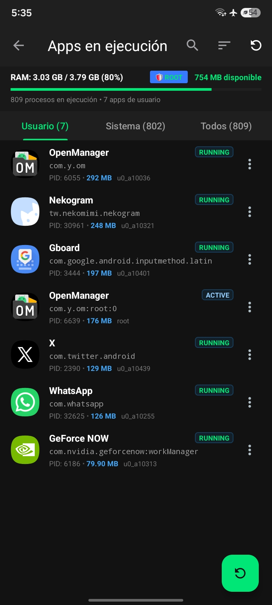
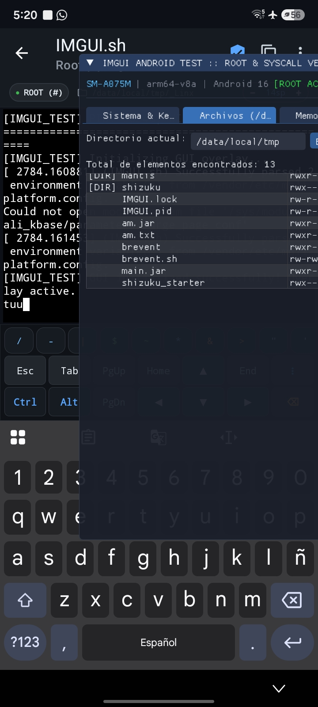
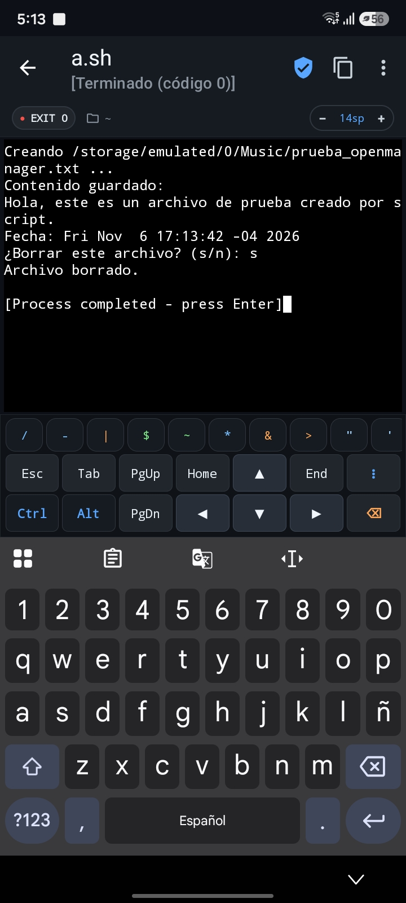

<p align="center">
  
</p>

<h1 align="center">OpenManager</h1>
<p align="center"><b>Open-source dual-pane file manager and reverse engineering suite for Android</b></p>
<p align="center"><i>Complete, modern, and 100% free alternative to MT Manager</i></p>

<p align="center">
  <a href="https://uamo11.github.io/OpenManager/"></a>
  <a href="https://github.com/uamo11/OpenManager/actions/workflows/android.yml"></a>
  <a href="https://github.com/uamo11/OpenManager/releases"></a>
  <a href="LICENSE"></a>
  
  
  
</p>

<p align="center">
  🌐 <b>Official Website:</b> <a href="https://uamo11.github.io/OpenManager/"><b>uamo11.github.io/OpenManager</b></a><br>
  <a href="README_en.md">English</a> · <a href="README.md">Español</a> · <a href="README_zh-CN.md">简体中文</a>
</p>

---

## 📖 Overview

**OpenManager** is an advanced Android file manager featuring a **simultaneous dual-pane interface** (full MT Manager-style parity) and an **all-in-one reverse engineering and modding suite** built right into your mobile device.

It lets you smoothly manage internal storage, MicroSD cards, protected system partitions, and remote servers, while packing powerful tools to **decompile to Java (JADX), edit Smali/DEX code, inspect binaries with a HEX editor and Data Inspector, edit ARSC/AXML resources, merge split packages (AntiSplit), sign APKs (V1–V3), and run shell scripts in its built-in terminal with Root or Shizuku**—all without needing a PC.

It includes native integration for **Root** (Magisk, KernelSU, KernelSU Next, APatch) and **Shizuku** (rootless ADB access to `Android/data` and `Android/obb`), along with the exclusive **DFROOT / Dead Man** safety shield designed to prevent accidental system bricks.

---

## 📸 Screenshots (Preview)

<table align="center" width="100%">
  <tr>
    <td align="center" width="25%">
      <br>
      <sub><b>Dual Pane & MP3 Audio</b></sub>
    </td>
    <td align="center" width="25%">
      <br>
      <sub><b>Management & MT Menu</b></sub>
    </td>
    <td align="center" width="25%">
      <br>
      <sub><b>O(N) Code Editor</b></sub>
    </td>
    <td align="center" width="25%">
      <br>
      <sub><b>39-Language Syntax Selector</b></sub>
    </td>
  </tr>
  <tr>
    <td align="center" width="25%">
      <br>
      <sub><b>APK, JADX & Modding Suite</b></sub>
    </td>
    <td align="center" width="25%">
      <br>
      <sub><b>RAM & Root Process Monitor</b></sub>
    </td>
    <td align="center" width="25%">
      <br>
      <sub><b>Root Terminal (#) & Scripts</b></sub>
    </td>
    <td align="center" width="25%">
      <br>
      <sub><b>Interactive Shell Execution</b></sub>
    </td>
  </tr>
</table>

---

## ✨ Key Features

### 🗂️ 1. Dual-Pane Explorer (MT Manager Style)
* **Independent Panes A & B:** View and browse two different directories side by side with instant synchronization and split view.
* **Direct Cross-Pane Operations:** Fast copying, moving, and syncing of files between opposite panes.
* **Breadcrumbs Navigation Bar:** Path history with quick jump to parent levels and live disk statistics (folders, files, used and total space).
* **Quick Management Menu:** Filter, sort, search, select all, set folder as home, bookmarks, and seamless pane swapping.

### 🛠️ 2. Reverse Engineering & Modding Suite
* **DEX & DEX Plus Editor:**
  * Real-time Smali disassembly and assembly powered by Baksmali/Smali.
  * Hierarchical browser for packages, classes, methods, fields, and global string pool (`string_ids`).
  * Atomic saving directly back to `.dex` with clean recompilation.
* **Integrated JADX Decompiler:** Inspect readable Java source code from APK and DEX files on the fly.
* **Virtualized HEX Editor:**
  * Ultra-smooth row-by-row performance (16 bytes per line with offset, hexadecimal, and ASCII).
  * **Data Inspector:** Real-time interpretation (Int8, Int16 LE, Int32 LE, Float32, Binary, and ASCII).
  * Flexible search & replace for text strings or byte sequences.
  * Undo / Redo history, direct offset jump, and checksum calculation (MD5, SHA-1, SHA-256).
* **ARSC Resource Editor (`resources.arsc`):**
  * Tabbed browsing (Strings, Resources, Packages) with direct value editing and automatic chunk recalculation.
* **Binary AXML Engine:**
  * Decoding and rebuilding of binary `AndroidManifest.xml` with string pool updates.

### 📦 3. APK Tools, Signing & AntiSplit
* **APK Quick Actions Menu (App Manager):**
  * Direct actions for any app: **Extract APK**, **Locate in explorer**, **Locate Data (`/data/data`)**, **View components (Activities, Services, Permissions)**, **View `AndroidManifest.xml`**, **Quick Edit**, **Decompile to Java (JADX)**, and **Share APK**.
* **AntiSplit Engine (Split APK Merger):**
  * Detects and merges split packages (`APKS`, `.xapk`, or multiple splits) into a single universal, self-signed APK.
* **Advanced Digital Signing:** Support for **V1 (Jar Signature)**, **V2 (Full APK Signature)**, and **V3 (APK Signature Scheme v3)** with signature and certificate verification.
* **In-App Keystore Generator (.jks):**
  * Create custom keystores (RSA 2048 / 4096 bits) directly inside the app via BouncyCastle, without needing a PC or `keytool`.
* **Apktool Decompile & Rebuild:** Unpack and rebuild resources and manifests right on your phone.
* **Zipalign Optimization:** 4-byte binary alignment for optimal Android compatibility and execution.
* **Icon Viewer & Extractor:** High-definition preview and PNG export to `/sdcard/Download/`.

### 🛡️ 4. Superuser, Shizuku & DFROOT "Dead Man" Protection
* **Full Root Compatibility:** Integration with **Magisk**, **KernelSU**, **KernelSU Next**, and **APatch** via libsu.
* **Native Shizuku Support:**
  * Direct binder communication for rootless administrative access to restricted folders (`/Android/data` and `/Android/obb`) on Android 11–15+.
  * Shizuku server detection (ADB API vs Root API) and privileged installation of APKs and Split APKs.
* **DFROOT "Dead Man" Safety System:**
  * Preventive protection against bricks on devices with **DFRoot / DirtyFlag** and locked bootloaders.
  * Proactive blocking of dangerous commands (`mount remount`, raw writes to `/dev/block/`, deletion of `/system`, `/vendor`, etc.).
  * **"DirtyFlag Protection" Dialog:** Forced 5-second countdown with explicit risk warning before allowing changes on critical partitions.
  * Categorized viewer of protected files (boot images, AVB firmware, startup files, and raw nodes).

### 💻 5. High-Performance Code & Text Editor
* **Background $O(N)$ Tokenizer:** Smooth syntax highlighting for **39 languages** (C/C++, Shell/Bash, SQL, XML, HTML, JSON, YAML, TOML, Markdown, Rust, Go, Python, etc.).
* **Keyboard Shortcut Bar:** Precision arrow keys, quick indent/unindent, TAB key, Undo/Redo, and search.
* **Advanced Editing:** Search & replace with regular expressions (regex), case sensitivity, and interactive match counter.
* **Interactive Status Bar:** Quick **LF ⇄ CRLF** line-ending toggle, encoding selector (UTF-8, GBK, UTF-16, ISO-8859-1), syntax selector, and go-to-line.

### ⚡ 6. Process Manager & Running Apps
* **Live Memory Monitor:** Real-time RAM usage monitoring (PSS, VmRSS, Java Heap) with status card.
* **Process Control:** Force stop and kill system or user processes with privilege badges (`🛡️ ROOT` / `⚡ SHIZUKU`).
* **Category Filters:** Dedicated tabs for **User**, **System**, and **All** processes.
* **Ultra-Fast APK Extraction:** Zero-copy I/O transfer (`FileChannel.transferTo`).

### 🌐 7. Network, Terminal & Multimedia
* **Built-in Terminal with Root Support (#):**
  * Interactive shell with extended terminal keyboard (Esc, Tab, Ctrl, Alt, arrows, PgUp, PgDn, Home, End).
  * Shell script (`.sh`) execution with interactive output capture, exit-code indicator (`EXIT 0`), and live font zoom.
  * Support for debugging commands, syscalls, `/data/local/tmp` binaries, and **Termux** integration.
* **Built-in Document & Media Viewers:** Native **PDF** and **DOCX** readers, floating **MP3/Audio player** (1.0x–2.0x speed, ±10s skip, loop), video player, and high-res image viewer.
* **Built-in FTP Server:** Share files wirelessly over your local network with any PC or browser.
* **Multi-Protocol Network Client:** Connect to **FTP, SFTP, SMB (Windows Share), and WebDAV** servers.

---

## 📊 Comparison with MT Manager

| Feature | MT Manager (Original) | OpenManager |
| :--- | :---: | :---: |
| **License** | Closed Source (Proprietary) | **100% Open Source (GPLv3)** |
| **Ads & Trackers** | Yes | **Zero Ads / Zero Telemetry** |
| **Simultaneous Dual Pane** | ✅ | ✅ |
| **DEX / Smali Editing** | Requires VIP (Paid) | **Completely Free** |
| **JADX Decompilation** | Requires VIP (Paid) | **Completely Free** |
| **HEX Editor + Data Inspector** | ✅ | ✅ |
| **ARSC & AXML Editor** | Requires VIP (Paid) | **Completely Free** |
| **AntiSplit Merger (Split APKs)** | ✅ | ✅ |
| **Shizuku Support (Rootless)** | Limited / Non-native | **Full Native Integration** |
| **DFROOT "Dead Man" Protection** | ❌ Not available | **Included out of the box** |
| **In-App Keystore Generator** | Limited | **RSA 2048/4096 (JKS, BKS, PK8)** |

---

## 🚀 Building from Source

### Prerequisites
* **JDK 21** (Java Development Kit)
* **Android SDK** with `platforms;android-36` and `build-tools;36.0.0`

### Build Instructions
```bash
# 1. Clone the repository
git clone https://github.com/uamo11/OpenManager.git
cd OpenManager

# 2. Build Debug APK
./gradlew assembleDebug

# Output APK will be generated at:
# app/build/outputs/apk/debug/app-debug.apk
```

To build signed **Release** versions, copy `signing.properties.example` to `signing.properties` and configure your keystore credentials.

---

## 📦 Releases & Downloads

Release notes, detailed changelogs, and official builds are published on GitHub Releases:

👉 **[View Releases on GitHub](https://github.com/uamo11/OpenManager/releases)**

---

## 🤝 Contributing

Contributions, bug reports, and feature requests are always welcome!

1. 🐛 **Found a bug?** Submit a detailed report via [New Bug Report](https://github.com/uamo11/OpenManager/issues/new/choose).
2. 💡 **Have an idea or suggestion?** Open a [Feature Request](https://github.com/uamo11/OpenManager/issues/new/choose).
3. 🔧 **Want to contribute code?** Fork the repo, create a feature branch, and open a Pull Request.

---

## 🛡️ Security & Privacy

OpenManager runs 100% locally on your mobile device. It never collects, stores, or transmits personal data, files, or telemetry to third-party servers.

* [Security Policy (SECURITY.md)](SECURITY.md)
* [Privacy Policy (PRIVACY.md)](PRIVACY.md)

---

## 📜 License

OpenManager is distributed under the terms of the **GNU General Public License v3.0 (GPL v3)**. See [LICENSE](LICENSE) for details.

```text
OpenManager - Open Source Dual-Panel File Manager for Android
Copyright (C) 2018-2026 Hai Zhang, uamo11 & Contributors.

This program is free software: you can redistribute it and/or modify
it under the terms of the GNU General Public License as published by
the Free Software Foundation, either version 3 of the License, or
(at your option) any later version.
```
