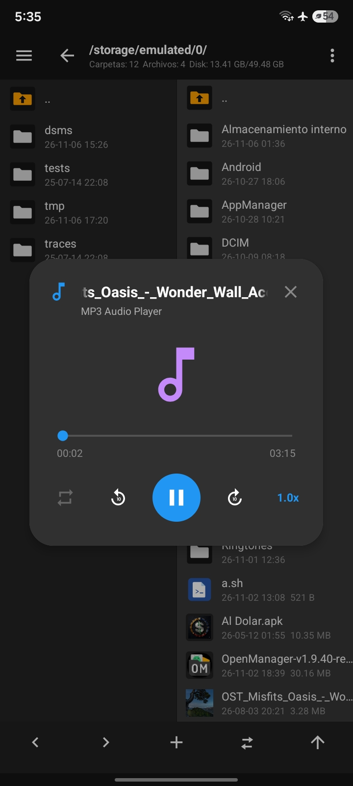
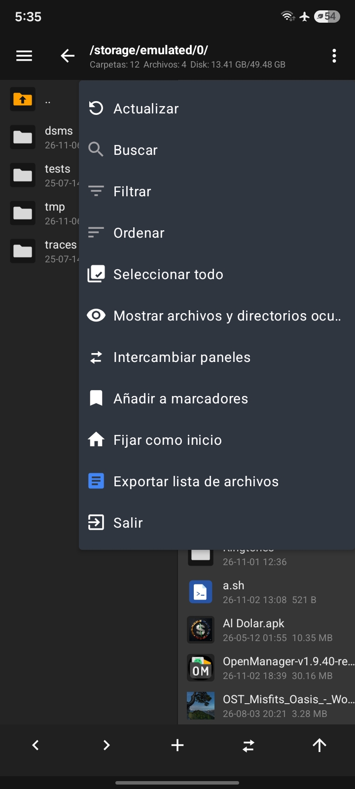
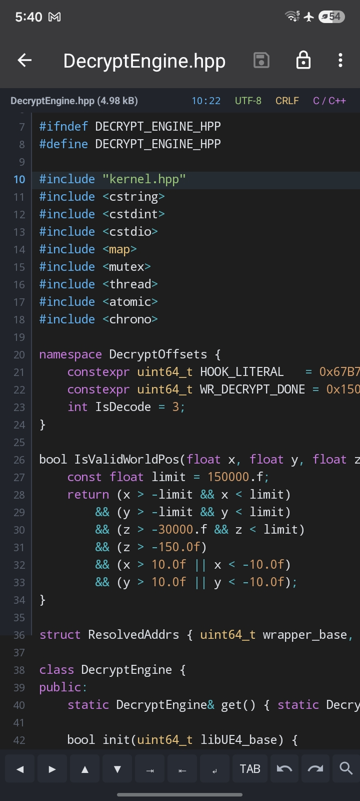
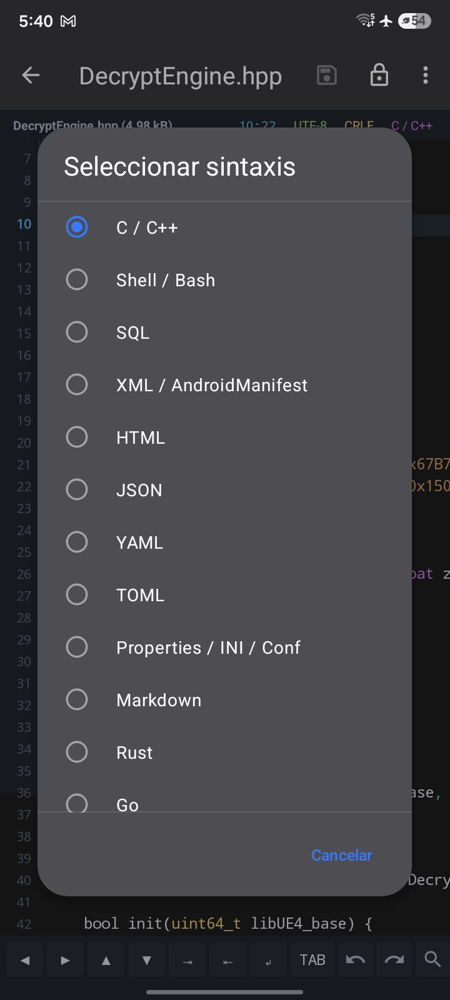
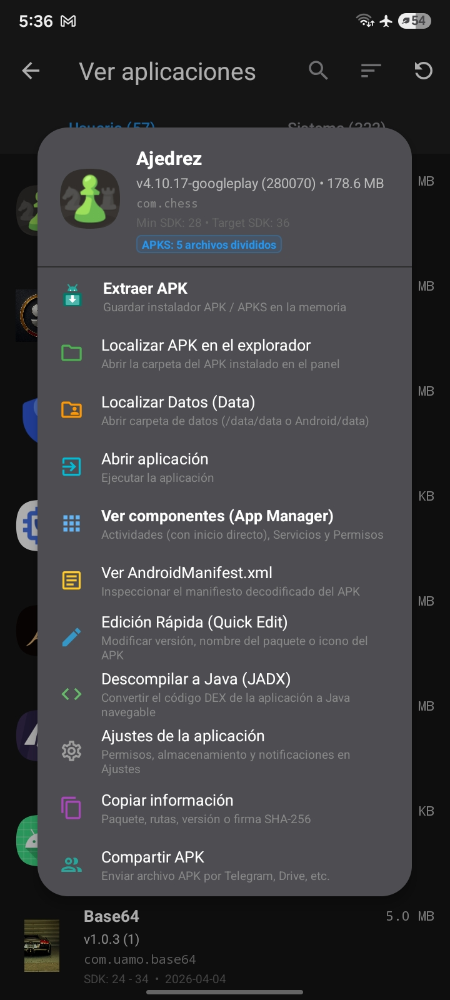
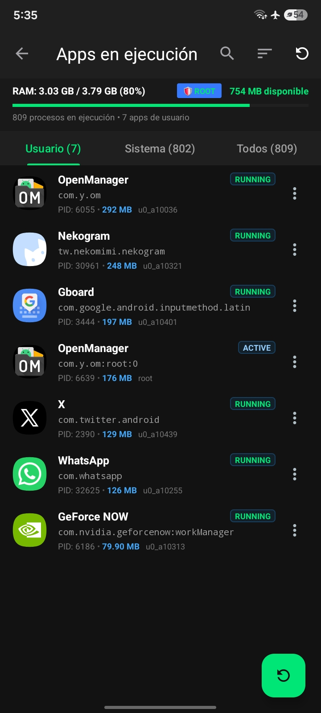
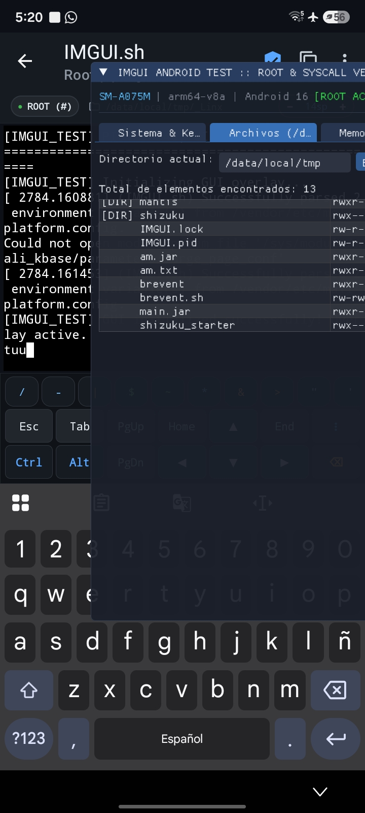
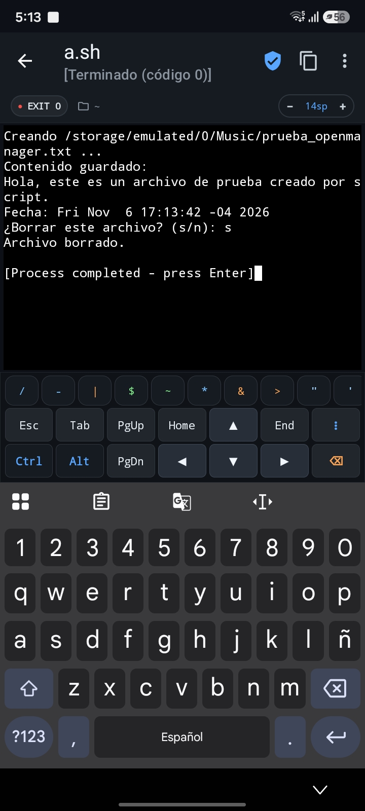

<p align="center">
  
</p>

<h1 align="center">OpenManager</h1>
<p align="center"><b>适用于 Android 的开源双面板文件管理器与移动端逆向工程套件</b></p>
<p align="center"><i>MT 管理器（MT Manager）的现代、全功能、100% 开源免费替代方案</i></p>

<p align="center">
  <a href="https://github.com/uamo11/OpenManager/actions/workflows/android.yml"></a>
  <a href="https://github.com/uamo11/OpenManager/releases"></a>
  <a href="LICENSE"></a>
  
  
  
</p>

<p align="center">
  <a href="README.md">Español</a> · <a href="README_zh-CN.md">简体中文</a>
</p>

---

## 📖 项目简介

**OpenManager** 是一款适用于 Android 的现代化、开源、功能强大的**双面板文件管理器**（MT Manager 风格），并在移动端直接集成了**全套逆向工程与修改工具箱**。

它不仅能高效管理设备内部存储、MicroSD 卡、系统保护分区与远程服务器，还允许用户直接在 Android 手机上**反编译、修改、回编译、签名并优化 APK、DEX、ARSC 和 AXML 文件**，无需借助电脑。

本应用完整支持 **Root**（Magisk、KernelSU、KernelSU Next、APatch）与 **Shizuku**（免 Root 借助 ADB 访问 Android 11–15 受限目录），并配备独家 **DFROOT / Hombre Muerto（死人开关）** 防变砖安全机制。

---

## 📸 界面预览

<table align="center" width="100%">
  <tr>
    <td align="center" width="25%">
      <br>
      <sub><b>双面板与悬浮音频</b></sub>
    </td>
    <td align="center" width="25%">
      <br>
      <sub><b>面板管理与快捷菜单</b></sub>
    </td>
    <td align="center" width="25%">
      <br>
      <sub><b>高敏代码编辑器 $O(N)$</b></sub>
    </td>
    <td align="center" width="25%">
      <br>
      <sub><b>39 种编程语言选择器</b></sub>
    </td>
  </tr>
  <tr>
    <td align="center" width="25%">
      <br>
      <sub><b>APK 工具、JADX 与反编译</b></sub>
    </td>
    <td align="center" width="25%">
      <br>
      <sub><b>实时 RAM 与 Root 进程</b></sub>
    </td>
    <td align="center" width="25%">
      <br>
      <sub><b>Root (#) 终端与脚本</b></sub>
    </td>
    <td align="center" width="25%">
      <br>
      <sub><b>Shell 脚本交互运行</b></sub>
    </td>
  </tr>
</table>

---

## ✨ 核心特性

### 🗂️ 1. 双面板文件浏览器（MT 风格）
* **独立 A/B 双面板：** 并行浏览两个不同路径，实时同步。
* **极速跨面板操作：** 一键在左右面板间快速复制、移动、提取或同步文件。
* **面包屑路径导航：** 快速跳转上级目录，实时显示磁盘项数与已用/可用容量。
* **便捷导航：** 预置下载目录、SD 卡、`/data/data`、系统目录及自定义书签快速直达。

### 🛠️ 2. 逆向工程与二进制修改套件
* **DEX & DEX Plus 编辑器：**
  * 基于 Baksmali/Smali 实现实时的 Smali 代码反汇编与汇编。
  * 树状浏览包名、类、方法、字段以及全局字符串池 (`string_ids`)。
  * 原子性保存并直接回写 `.dex` 文件。
* **集成 JADX 反编译器：** 快速将 APK / DEX 反编译为易读的 Java 源代码并直接查阅。
* **高性能虚拟化 HEX 编辑器：**
  * 每行 16 字节极速滚动，包含偏移量、十六进制与 ASCII。
  * **实时数据检查器（Data Inspector）：** 自动解析 Int8、Int16 LE、Int32 LE、Float32、二进制与 ASCII。
  * 支持十六进制/文本双向查找与替换、撤回/重做、跳转偏移量与校验和计算（MD5、SHA-1、SHA-256）。
* **ARSC 资源编辑器 (`resources.arsc`)：**
  * 选项卡式浏览字符串池、资源 ID、类型与包名，支持即时修改与 Chunk 长度自动重算。
* **二进制 AXML 引擎：**
  * 解码与重打包二进制 `AndroidManifest.xml`，自动维护字符串池。

### 📦 3. APK 综合工具箱、签名与 AntiSplit
* **应用管理快速操作：**
  * 提取 APK/APKS、在面板中定位、直达数据目录 (`/data/data`)、查看四大组件与权限、查看 decodes `AndroidManifest.xml`、快速编辑（Quick Edit）、Java 源码查看（JADX）与一键分享。
* **AntiSplit 拆分包合并引擎：**
  * 将 Split APKs（`APKS`、`.xapk` 或分离安装包）一键融合成单个独立运行、自动签名的通用 APK。
* **全方案数字签名：** 支持 **V1 (Jar 签名)**、**V2 (APK Signature Scheme v2)** 与 **V3 (APK Signature Scheme v3)**，带证书详细信息查看。
* **移动端 Keystore 密钥生成器：**
  * 基于 BouncyCastle，无需 PC `keytool`，即可在手机上生成 RSA 2048/4096 位的签名证书（.jks、.bks、.pk8 + .pem）。
* **Apktool 移动端引擎：** 手机端直接解包与重建 APK 资源与清单。
* **Zipalign 字节对齐优化：** 确保 APK 满足 4 字节对齐标准。
* **应用图标提取与高清查看：** 支持将高清图标导出为 PNG 保存至本地存储。

### 🛡️ 4. Root、Shizuku 与 DFROOT 防变砖系统
* **全面 Root 适配：** 支持 **Magisk**、**KernelSU**、**KernelSU Next** 与 **APatch**（基于 libsu）。
* **原生 Shizuku 适配：**
  * 通过 Binder 直连获取免 Root 管理员权限，无障碍访问 Android 11 至 15 的 `/Android/data` 与 `/Android/obb` 目录。
  * 自动识别 Shizuku 模式（ADB API / Root API），支持特权静默安装应用。
* **DFROOT "Hombre Muerto"（死人开关）安全保护：**
  * 专为 **DFRoot / DirtyFlag** 越狱及锁定 Bootloader 设备研发的系统保护锁。
  * 智能拦截危险底层命令（阻止危险的 `mount remount`、写入 `/dev/block/` 底层块设备或破坏系统分区）。
  * **DirtyFlag Protection 警告弹窗：** 高危操作触发强制 5 秒倒计时确认与引导。
  * 分类式保护清单：清晰展示 Boot 分区、AVB 安全固件、系统初始化节点等受保护资源。

### 💻 5. 高性能代码与文本编辑器
* **后台 $O(N)$ 语法分析引擎：** 支持 **39 种编程语言**的高亮显示与平滑滚动。
* **键盘操作栏：** 精准方向键、快速缩进/反缩进、TAB 键、撤销/重做与实时搜索。
* **强大编辑能力：** 支持正则表达式（Regex）查找与替换、区分大小写以及实时匹配统计。
* **交互式底部状态栏：** 一键切换换行符（**LF ⇄ CRLF**）、字符编码选择（UTF-8、GBK 等）与快速跳转行号。

### ⚡ 6. 进程管理与运行中应用监控
* **物理内存实时监控：** 实时获取各进程物理内存占用（PSS、VmRSS、Java Heap），配有直观的 RAM 进度条。
* **进程精细控制：** 支持普通/系统进程强行停止，带有权限提升徽章（`🛡️ ROOT` / `⚡ SHIZUKU`）。
* **分类视图：** 快速切换用户进程、系统服务或全部进程。
* **零拷贝 APK 提取：** 使用 `FileChannel.transferTo` 高速管道，极速备份安装包。

### 🌐 7. 网络传输、终端与多媒体
* **内置终端仿真器：**
  * 全功能交互式 Shell，配备完整虚拟按键栏（Esc、Tab、Ctrl、Alt、方向键、PgUp、PgDn、Home、End）。
  * 支持交互运行 `.sh` 脚本，显示返回码状态（`EXIT 0`）与即时字体缩放。
  * 完美支持 `/data/local/tmp` 脚本、底层 Syscall 调试与 **Termux** 调用。
* **悬浮音乐播放器：** 独立模态窗口播放音频文件，支持变速（1.0x 至 2.0x）、±10 秒快进/快退与循环模式。
* **内置 FTP 服务器：** 手机即刻变身局域网无线服务器，电脑浏览器或资源管理器随时无线互传。
* **多协议网络客户端：** 连接并管理 **FTP、SFTP、SMB (Windows 共享) 与 WebDAV** 远程文件。

---

## 📊 与 MT 管理器对比

| 功能模块 | MT 管理器 (MT Manager) | OpenManager |
| :--- | :---: | :---: |
| **开源协议** | 闭源专有软件 | **100% 开源 (GNU GPLv3)** |
| **广告与追踪** | 包含广告与追踪组件 | **完全无广告 / 零隐私收集** |
| **双面板文件管理** | ✅ | ✅ |
| **DEX / Smali 编辑** | 需开通 VIP 会员 | **完全免费** |
| **JADX 源码查看** | 需开通 VIP 会员 | **完全免费** |
| **HEX 虚拟化编辑器** | ✅ | ✅ |
| **ARSC & AXML 编辑** | 需开通 VIP 会员 | **完全免费** |
| **AntiSplit 拆分包合并** | ✅ | ✅ |
| **Shizuku 免 Root 深度支持**| 有限 / 非深度原生 | **深度原生支持** |
| **DFROOT 防变砖保护机制** | ❌ 无 | **系统级标配** |
| **手机端 Keystore 生成** | 功能有限 | **RSA 2048/4096 (JKS, BKS, PK8)** |

---

## 🚀 从源码编译

### 环境准备
* **JDK 21**
* **Android SDK**（包含 `platforms;android-35` 及 `build-tools;35.0.0`）

### 编译步骤
```bash
git clone https://github.com/uamo11/OpenManager.git
cd OpenManager
./gradlew assembleDebug
# 编译产物位于: app/build/outputs/apk/debug/app-debug.apk
```

---

## 📦 发布版本与更新

所有正式版本的发布日志、变更记录均同步托管在 GitHub Releases 官方页面：

👉 **[前往 GitHub Releases 查阅各版本](https://github.com/uamo11/OpenManager/releases)**

---

## 🤝 参与贡献

欢迎提出 Issue、建议或提交代码合并请求（PR）：

1. 🐛 **报告缺陷：** [提交 Bug 反馈](https://github.com/uamo11/OpenManager/issues/new/choose)。
2. 💡 **功能建议：** [提交 Feature Request](https://github.com/uamo11/OpenManager/issues/new/choose)。
3. 🔧 **贡献代码：** Fork 本仓库，创建新分支，并在验证测试通过后发起 Pull Request。

---

## 🛡️ 安全与隐私

OpenManager 仅在本地运行，不收集、不出售任何个人文件或用户隐私数据。

* [安全政策 (SECURITY.md)](SECURITY.md)
* [隐私声明 (PRIVACY.md)](PRIVACY.md)

---

## 📜 开源许可证

OpenManager 遵循 **GNU General Public License v3.0 (GPL v3)** 协议开源。详见 [LICENSE](LICENSE) 文件。

```text
OpenManager - Open Source Dual-Panel File Manager for Android
Copyright (C) 2018-2026 Hai Zhang, uamo11 与贡献者们。

This program is free software: you can redistribute it and/or modify
it under the terms of the GNU General Public License as published by
the Free Software Foundation, either version 3 of the License, or
(at your option) any later version.
```
